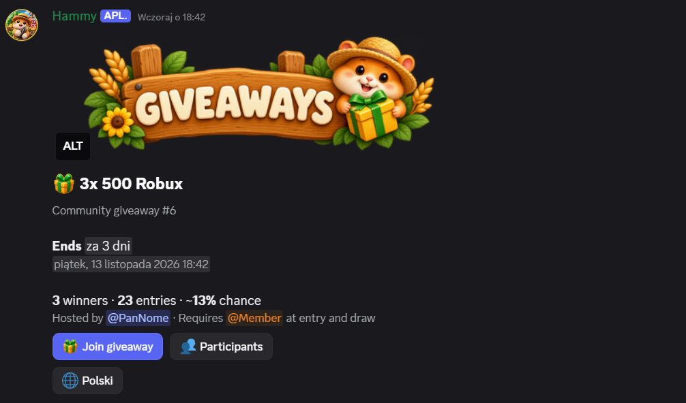
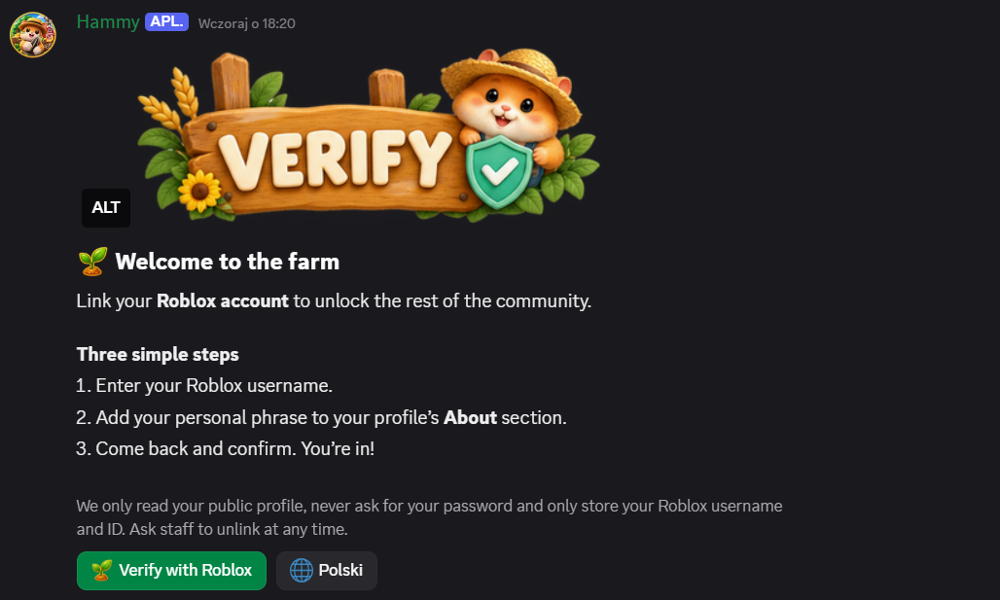
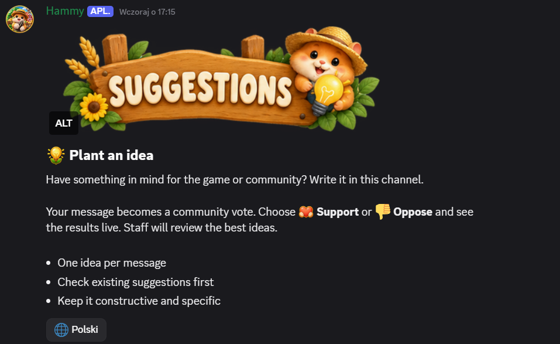
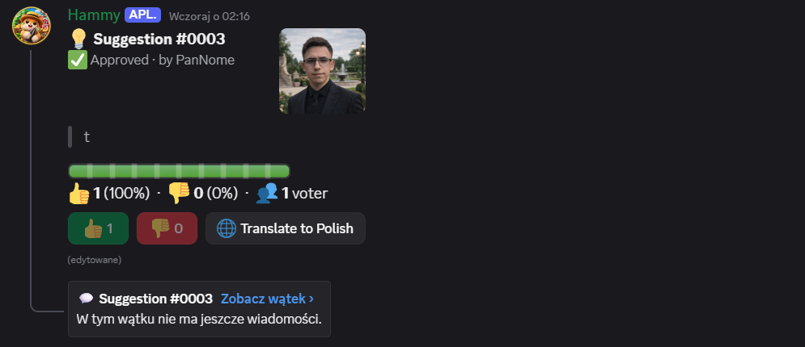

# Hamster Bot


<div align="center">
  
  
  <br/>
  
  
</div>

Discord bot for Roblox communities, built with discord.js. It brings verification, community features and server configuration together, with MySQL for persistent data.

Features include Roblox verification, surveys, giveaways, codes, suggestions, bug reports, community showcases, boost notifications and English-to-Polish translations of bot messages.

## Requirements

- Node.js 22.13 or newer
- MySQL
- A bot application from the [Discord Developer Portal](https://discord.com/developers/applications)

## Setup

1. Create a Discord application and bot, copy its token, and enable **Message Content Intent** in the bot settings.
2. Copy `.env.example` to `.env` and fill in the bot token and MySQL connection details. `GUILD_ID` is optional; when set, commands are registered to that server for testing. Otherwise, they are registered globally.
3. Install dependencies and start the bot:

   ```sh
   npm install
   npm start
   ```

4. Invite the bot with the `bot` and `applications.commands` scopes. Grant the permissions required by the features you plan to use, including View Channels, Send Messages, Embed Links, Attach Files, Add Reactions, Manage Messages, Manage Roles, Create Public Threads and Read Message History. Enable Mention Everyone if the bot needs to ping a configured role. The bot's role must be higher than the roles it manages.

Keep `.env` local; it contains credentials. Use `.env.example` as the template when setting up another copy of the project.

## Pierwsza konfiguracja (administrator)

- `/config channel` – kanały: suggestions, bugs, screenshots, clips, fanarts, codes, notifications, surveys, giveaways i boosts
- `/config role` – role: verified, staff, content, ping
- `/panel type:<rules|verify|links|bugs|suggestions|screenshots|clips|fanarts>` – wysyła panel z banerem na górze
- `/link add|remove|list` – linki (TikTok, gra, grupa…)
- `/code add|list|uses|expire|remove|goal` – kody; kolejne odkrywają się po osiągnięciu celu reakcji 🎉
- `/survey create|close|list` – ankiety z żywymi głosami
- `/giveaway create|list|end|reroll|cancel|edit` – zaplanowane konkursy z opisem, listą uczestników, szansą wygranej, automatycznym losowaniem i ponownym losowaniem. Udział wymaga przypisanej w kodzie roli member; rola jest sprawdzana przy zapisie i losowaniu.
- Przycisk `Participants` na wiadomości konkursowej pokazuje prywatną listę zapisanych uczestników, po 20 osób na stronie, również po zakończeniu konkursu. Lista i licznik obejmują wszystkie zapisane zgłoszenia; utrata roli wyklucza z losowania. Lista nie wysyła pingów.
- Licznik uczestników jest odczytywany z bazy przy każdej aktualizacji. Aktualizacje jednego konkursu są wykonywane kolejno, aby równoczesne zgłoszenia nie nadpisywały nowszej liczby. Istniejący baner jest zachowywany bez ponownego przesyłania; błąd odświeżenia jest zgłaszany użytkownikowi i w logach.
- Jeśli podczas odświeżania giveaway’a Discord potwierdzi usunięcie wiadomości (`Unknown Message`), bot usuwa konkurs, uczestników i wyniki z bazy, aby nie ponawiać wyszukiwania. Błędy sieci i brak uprawnień nie usuwają danych.
- `/content link [message]` – powiadomienie o nowym materiale (rola `content` lub Manage Server)
- `/suggestion id status reason`, `/roblox whois|unlink`, `/top`

## Reaction-role

Konfiguracja dowolnych paneli wymaga **Manage Server** i **Manage Roles**. Tytuł, opis, etykiety, emoji i role ustawiasz komendami, bez zmian w kodzie.

1. `/reaction-role create title:Choose your languages description:Możesz wybrać oba języki! You can choose both languages!`
2. Odczytaj ID nowego panelu z odpowiedzi, np. `1`.
3. `/reaction-role add id:1 emoji:🇵🇱 role:@Polski label:Polski`
4. `/reaction-role add id:1 emoji:🇬🇧 role:@English label:English`
5. `/reaction-role post id:1 channel:#roles`

- Panel ma farmerski nagłówek i przycisk `🌐 Polski`. Dodanie reakcji nadaje rolę, usunięcie ją odbiera. Można wybrać kilka ról naraz.
- Maksymalnie 20 par na panel; emoji Unicode lub niestandardowe emoji z tego serwera. Każda rola i każde emoji mogą wystąpić tylko raz w panelu.
- `/reaction-role list` pokazuje ID paneli. `/reaction-role remove id:1 emoji:🇵🇱` usuwa opcję ze szkicu. Ponowne `add` dla tego samego emoji zmienia przypisaną rolę/etykietę.
- Opublikowane mapowania są stałe: aby je zmienić, utwórz nowy panel. `/reaction-role delete id:1` usuwa panel i jego wiadomość, ale zachowuje nadane wcześniej role.
- Bot potrzebuje **Manage Roles**, roli wyższej od nadawanych ról oraz **View Channel**, **Send Messages**, **Read Message History** i **Add Reactions** na kanale. Role muszą być także poniżej najwyższej roli administratora konfigurującego panel (z wyjątkiem właściciela serwera). Role zarządzane i `@everyone` są niedozwolone.
- Konfiguracja jest przechowywana w MySQL i działa po restarcie, także dla niebuforowanych wiadomości. Reakcje zmienione, gdy bot był offline, nie są automatycznie synchronizowane; użytkownik powinien ponownie dodać/usunąć reakcję. Błędy nadawania/odbierania ról są zapisywane w logach `[reaction-role]`.
- Testy paneli reakcji: `node --test scripts/reaction-roles.test.js`.

## Uwagi

- Boosty: włącz w ustawieniach serwera „Send a message when someone boosts”; bot wysyła jedno powiadomienie na każdą wiadomość o boostcie.
- Translate używa nieoficjalnego endpointu Google; tłumaczy wyłącznie tekst bota (nigdy wiadomości użytkowników). Do produkcji rozważ DeepL/LibreTranslate.
- Weryfikacja Roblox: użytkownik wkleja wygenerowaną frazę do opisu profilu (nigdy hasło). Jedno konto Roblox = jedno konto Discord.
- Banery: `img\<nazwa>.png` (rules, verify, links, bugs, suggestions, screenshots, clips, fanarts, codes, surveys, content, boost, giveaways). Podmień plik, aby zmienić grafikę. Baner giveawayów jest dołączany przy tworzeniu i odświeżaniu konkursu.
- Każdy baner jest osobnym PNG 480 × 160 px z przezroczystym tłem i nieregularnym farmerskim obrysem. Panele i powiadomienia dołączają go nad tekstem. Po podmianie grafik ponownie wyślij panele przez `/panel`; stare wiadomości nie zmienią się automatycznie.
- Wygląd wiadomości: bez ramek i embedów, z nagłówkami, odstępami między sekcjami i krótkimi stopkami. Przycisk `🌐 Polski` tłumaczy tekst; przyciski akcji zachowują swoje działanie.
- Farmerskie emoji: dodaj osobne PNG z `img\emoji` na serwer pod nazwami `farm_sprout`, `farm_heart`, `farm_paw`, `farm_idea`, `farm_check`, `farm_bug`, `farm_gift`, `farm_water`. Bot odszukuje je po nazwach na danym serwerze i używa w nagłówkach oraz przyciskach, również po aktualizacji wiadomości. Brak lub niedostępność emoji powoduje ostrzeżenie w logach i użycie standardowej ikony. Istniejące paski głosowania nadal używają swojego zestawu emoji; reakcje odblokowujące kody i rankingi galerii pozostają bez zmian.
- `npm run test:ui` sprawdza układ wiadomości bez połączenia z Discordem, bazą danych ani usługą tłumaczenia.
- `npm run check` sprawdza komendy i przykładowe wiadomości; pełne testy wymagają dostępnej bazy MySQL.
- Dane są przechowywane w MySQL skonfigurowanym przez `DB_HOST`, `DB_USER` i `DB_NAME`.
